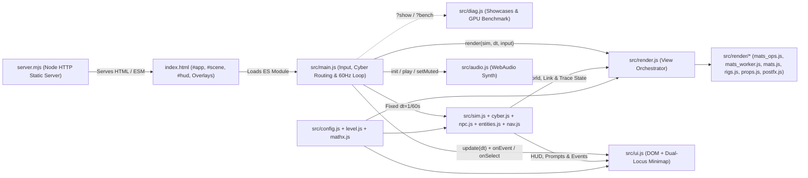

# Silence (SILENT PROTOCOL) Blueprint

## System Overview

**SILENT PROTOCOL — Unidad S-7** (`silence`) is a zero-build 3D social-stealth and cyber-infiltration web game built with ES modules, bundled Three.js `r160` (`./vendor/three.module.js`), procedural WebGL2 PBR (`1024x1024` progressive Web Worker node-graph textures adapted from `storytold/materialcraft`), a seam-blended `360°` nocturnal coastal skybox (`./assets/sky/aurora_night_pano.jpg`) driving inverse-tonemapped HDR `PMREM` reflections + HDR Bloom rendering, articulated FK/IK character and robotic rigs with distinct VIP/enforcer silhouettes, HTML5 HUD overlays, WebAudio synthesis, and a hardened Node.js static HTTP server (`./server.mjs`). Players control infiltration android S-7 inside Mansion Aurora to eliminate two high-value targets (Marcus Vandermeer and Dr. Elena Kessler), exfiltrate the Aurora data core, and extract by boat — combining Hitman-style disguises, environmental accidents, poison, and rear takedowns with Watch Dogs-style RF-attenuated remote hacking, CCTV camera network hopping, quadruped bot hijacking through low vents, and active security signal tracing.

- **Play online (GitHub Pages)**: https://mauricioperera.github.io/silent-protocol/
- **Run locally**: `npm start` (`node server.mjs`) and open `http://127.0.0.1:8080`.

## Local Interface & Invariants

- **Static HTTP Server (`./server.mjs` & `./package.json`)**:
  - `[server.mjs:DEFAULT_ROOT]` — Canonical repository root resolved via `fileURLToPath(new URL('.', import.meta.url))` (independent of caller `process.cwd()`).
  - `[server.mjs:createStaticHandler]` — `createStaticHandler(rootDir = DEFAULT_ROOT) => async (req, res) => void`: exports the testable HTTP handler. Allows only `GET` and `HEAD` (`405` with `allow: GET, HEAD` otherwise); catches malformed percent-encoding and NUL bytes (`400`); validates both lexical `resolve`/`relative` and canonical `realpath` against `rootDir`, returning `403` on sibling-prefix traversal (`..`), absolute escapes, or dotfile segments (`.git`, etc.); resolves directories to `index.html` and verifies `s.isFile()` (`404` otherwise); omits response body reads on `HEAD`; sets `cache-control: no-cache` and `x-content-type-options: nosniff` without wildcard CORS; and returns generic `'internal error'` on `500`.
  - `[server.mjs:PORT]` & `[server.mjs:HOST]` — Direct CLI execution (`node server.mjs` / `npm start`) binds `HOST` (`process.env.HOST || '127.0.0.1'`) on `PORT` (`process.env.PORT ? Number(process.env.PORT) : 8080`).
- **Application Shell (`./index.html`)**:
  - `[index.html:#app]` & `[index.html:#scene]` — Full-viewport container, WebGL `<canvas id="scene">`, and screen-space effect layers (`#instinctTint`, `#vignette`, `#scan`, `#damage`).
  - `[index.html:#hud]` — HUD DOM structure containing CSS layout panels (`#missionPanel`, `#disguisePanel`, `#statusPanel`, `#mapPanel`, `#mapLegend`), surveillance portrait cards (`#hudTargets`, `#hudTgt-vandermeer`, `#hudTgt-kessler`, `#s7HudAvatar`), contextual cyber banners (`#linkBanner` with `#linkText`/`#linkWarn`, and `#traceBar` with `#traceLabel`/`#tracePct`/`#traceFill`), and JS-queried elements required by `src/ui.js` and `src/main.js`: `#clock`, `#objectives`, `#alertBanner`, `#alertText`, `#disguiseName`, `#disguiseHint`, `#zoneNow`, `#zoneChips`, `#integrityTxt`, `#integrityBar`, `#instinctBar`, `#miniStats`, `#log`, `#hotbar`, `#channelBar`, `#channelLabel`, `#channelFill`, `#prompt`, `#promptKey`, `#promptText`, `#extras`, `#crosshair`, `#suspicionRing` (requiring child `.who` and `<svg>` `circle.val` consuming CSS custom property `--v`), `#hint`, `#fps`, `#markers`, and `<canvas id="minimap" width="260" height="300">`.
  - `[index.html:#startScreen]`, `[index.html:#pauseScreen]`, `[index.html:#endScreen]` — Modal lifecycle overlays exposing `#qualitySel`/`#qualitySel2` (`high` | `medium` | `low`), `#sensSel`/`#sensSel2` (`[0.5, 3.0]`, step `0.1`, default `1.4`), `#startBtn`, `#resumeBtn`, `#restartBtn`, `#againBtn`, and end-of-mission summary nodes `#endTitle`, `#endRating`, `#endNote`, `#endScore`, and `#endStats`.
  - `[index.html:script]` — Bootstraps ``.

## Subdirectories & System Boundaries

- src: [./src/README.md](./src/README.md) - Core 2D XZ stealth & cyber simulation (`sim.js`, `cyber.js`, `npc.js`, `entities.js`, `nav.js`, `level.js`, `config.js`, `mathx.js`), Three.js WebGL2 orchestrator (`render.js` + [./src/render/README.md](./src/render/README.md)), on-demand diagnostic harness (`diag.js`), DOM/minimap HUD controller (`ui.js`), and WebAudio synth (`audio.js`).
- docs: Design specifications (`./docs/designs/silent_protocol_2_pbr_cyber.md`).
- tests: Automated `node:test` + `node:assert/strict` verification suites (`./tests/sim.test.mjs` and `./tests/cyber_and_dag.test.mjs`).
- assets: Local first-party visual assets: nocturnal coastal skybox (`./assets/sky/aurora_night_pano.jpg`), Hitman-style agency dossier portraits (`./assets/dossier/s7.jpg`, `vandermeer.jpg`, `kessler.jpg`), and Mansion Aurora artwork/carpet textures (`./assets/art/carpet_ballroom.jpg`, `maritime_oil.jpg`).
- vendor: Vendored third-party Three.js `r160` ES module bundle (`./vendor/three.module.js`, excluded from first-party source contracts; see [./THIRD_PARTY_NOTICES.md](./THIRD_PARTY_NOTICES.md)).

## Global Invariants

- **DOM-to-Controller ID Coupling**: Every JS-queried element ID in `#scene`, `#hud` (including `#linkBanner`, `#linkText`, `#linkWarn`, `#traceBar`, `#traceLabel`, `#tracePct`, `#traceFill`), `#startScreen`, and `#pauseScreen` must exist when `src/main.js` evaluates, while `#endTitle`, `#endRating`, `#endNote`, `#endScore`, `#endStats`, and `#endScreen` must exist when `UI.showEnd()` runs.
- **Headless Simulation Isolation & Seeded Determinism**: Simulation modules (`src/config.js`, `src/mathx.js`, `src/level.js`, `src/nav.js`, `src/entities.js`, `src/npc.js`, `src/cyber.js`, `src/sim.js`) remain strictly free of `window`, `document`, WebGL, `THREE`, and `src/render/` imports, and produce bit-identical state across seeded `createSim({ seed })` runs.
- **Aligned World Bounds & Dual Navigation Grids**: Playable zones (`ZONES`) and human clamps span `x in [-22, 22]`, `z in [-18, 26]`; `Nav` rasterizes `BOUNDS` `x in [-22.6, 22.6]`, `z in [-18.6, 26.6]` (`76x76` cells of `0.6` m) separately for humans (`radius = 0.36` m, blocked by `WALLS`) and robotic units (`radius = 0.28` m, traversing `VENTS`); and `UI.drawMinimap` projects `x in [-23, 23]`, `z in [-19, 27]`. Simulation advances in fixed `1 / 60` s ticks.

## Global Side Effects

- **Network Binding**: Direct execution of `node server.mjs` binds an HTTP listener on `${HOST}:${PORT}` (`127.0.0.1:8080` by default); importing `server.mjs` as a module has no network side effects.
- **Filesystem Reads**: `createStaticHandler` performs asynchronous `fs.realpath`, `fs.stat`, and `fs.readFile` calls per incoming `GET`/`HEAD` request.
- **Browser Hardware Capture**: `src/main.js`, `src/render.js`, `src/diag.js`, and `src/audio.js` acquire WebGL2 rendering contexts, WebAudio synthesis nodes, and Pointer Lock on user interaction (bypassed automatically in `?show` and `?bench=1` diagnostic URLs).

## System Verification

- Headless unit & cyber/DAG tests: `npm test` (`node --test tests/sim.test.mjs tests/cyber_and_dag.test.mjs`)
- Visual showcases & GPU benchmark (with `npm start` running):
  - `http://127.0.0.1:8080/?show=mats` | `?show=rigs` | `?show=props` | `?show=units`
  - `http://127.0.0.1:8080/?bench=1&duration=10`
