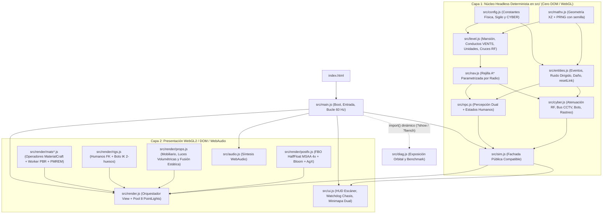

# SILENT PROTOCOL 2.0: Motor Procedural PBR/IK e Infiltración Cibernética

*   **Author:** Usuario & Antigravity (EGM Workflow)
*   **Status:** Approved
*   **Date:** 2026-11-16

--------------------------------------------------------------------------------

## Overview

Este documento especifica la evolución visual y sistémica de **SILENT PROTOCOL**, un juego de infiltración y sigilo social 3D en navegador sobre Three.js `r160` ([vendor/three.module.js](../../vendor/three.module.js)) sin dependencias de runtime ni activos multimedia externos.

El diseño aborda dos objetivos acoplados:

1.  **Modernización del motor gráfico procedural** hacia mapas PBR deterministas (`Albedo`, `ORM`, `Normal`), iluminación basada en entorno (`PMREMGenerator`), postprocesado HDR lineal con MSAA `4x`, Bloom piramidal y mapeo tonal `AgX`, conos volumétricos aditivos y rigs articulados multi-segmento (con cinemática inversa analítica en unidades robóticas) bajo un presupuesto verificable de `<= 350` llamadas de dibujado totales por fotograma.
2.  **Expansión de las mecánicas de androide infiltrado** integrando en el modo Instinto (`instinctOn`, rotulado *Escáner* en el HUD) hackeo remoto limitado por distancia y atenuación de muros, salto por red de cámaras (`cam-hopping`), control remoto de unidades robóticas terrestres a través de conductos bajos exclusivos (`VENTS`), vulnerabilidad física del chasis de S-7 durante la conexión y rastreo activo de señal gestionado por la sala de seguridad.

## The Problem

En el estado base del repositorio:

1.  **Techo visual de primitivas rígidas e iluminación plana:** Todos los personajes ([src/render.js](../../src/render.js)) son cajas sin codos ni rodillas, las superficies carecen de mapas de normales/rugosidad/oclusión y existen `17` luces puntuales simultáneas (`16` ambientales en [src/level.js](../../src/level.js) más `muzzleLight` en [src/render.js](../../src/render.js)) sin entorno `PMREM` ni postprocesado. Además, alternar el modo Instinto (`V`/`Tab`) muta propiedades de transparencia y fuerza recompilaciones GLSL en caliente.
2.  **Identidad de androide infrautilizada en la jugabilidad:** Aunque S-7 es una unidad cibernética, todas sus acciones (salvo la visión a través de muros del modo Instinto) son idénticas a las de un infiltrado humano cuerpo a cuerpo (`<= 2.6 m`). Faltan capacidades de infiltración electrónica (puenteo de cámaras, sobrecalentamiento remoto, control de unidades auxiliares) que se integren con las reglas de disfraz, supervisores (*enforcers*) y accidentes sin anularlas.
3.  **Riesgo de monolitos y pérdida de determinismo:** Concentrar materiales PBR, rigs articulados, postprocesado y sistemas de red dentro de [src/render.js](../../src/render.js) (`1.040` líneas) y [src/sim.js](../../src/sim.js) (`708` líneas), junto con el uso de `Math.random()` sin semilla en [src/npc.js](../../src/npc.js), impediría probar y depurar de forma reproducible las interacciones simultáneas entre el chasis estacionario de S-7 y una unidad remota controlada.

La solución mantiene plana la capa de simulación *headless* en `src/` (incorporando PRNG con semilla en [src/mathx.js](../../src/mathx.js) y el subsistema cibernético en `src/cyber.js`), modulariza el renderizador WebGL2 en `src/render/` más un módulo de diagnóstico bajo demanda (`src/diag.js`), sintetiza texturas PBR deterministas y entorno `PMREM` en el arranque, y acota la infiltración electrónica mediante energía de Instinto (`sim.player.instinct`), atenuación por muros, exposición del chasis físico de S-7 y contramedidas de rastreo.

## Goals

*   **Cero activos externos:** Generar el 100 % de mallas, texturas PBR (`Albedo`, `ORM`, `Normal` mediante grafo de operadores `TypedArray` en `mats_ops.js` con arranque instantáneo `256x256` y mejora asíncrona en `Web Worker` a `1024x1024` en `high` y `512x512` en `medium`), entorno `PMREM`, efectos visuales y síntesis WebAudio ([src/audio.js](../../src/audio.js)) por código.
*   **Presupuesto de rendimiento verificable:** Mantener `<= 8` `PointLight` con intensidad activa simultáneamente, `<= 350` *draw calls* totales por fotograma (midiendo sombras + escena + postprocesado con `renderer.info.autoReset = false`), cero recompilaciones de shaders tras el arranque, y verificar tiempos de fotograma `p50`/`p95`/`p99` mediante `?bench=1`.
*   **Rigs articulados y arquitectura fusionada:** Sustituir las cajas rígidas de humanos y S-7 por jerarquías articuladas (`<= 14` mallas por humanoide, proyectando sombra únicamente en tronco y muslos) e incorporar unidades robóticas terrestres con IK analítico de 2 huesos, verificables de forma aislada con `?show=mats|rigs|props|units`.
*   **Hackeo por proximidad sin romper el sigilo social:** Integrar el hackeo al apuntar dentro del modo Instinto (`V`/`Tab`) consumiendo energía de Instinto, con alcance efectivo desde el emisor RF activo atenuado por cada tabique físico cruzado (`alcanceEfectivo = alcanceBase - murosCruzados * 3.5 m`).
*   **Control remoto con vulnerabilidad real de S-7:** Permitir entrada por RF a cámaras activas seguida de conmutación por bus CCTV (`cam-hopping`) y pilotaje de bots terrestres por conductos bajos exclusivos (`VENTS`), dejando el chasis de S-7 inmóvil en estado `jackedIn` con desconexión automática de emergencia si recibe daño o la sospecha sobre el chasis alcanza `0.45`.
*   **Rastreo de señal compatible con *Asesino Silencioso*:** Vincular la detección de anomalías de red (`netHeat`) al Jefe de seguridad (`chief`) y a la consola `cams`: cruzar el umbral inicia una cuenta atrás de rastreo (`0..1`) evadible; solo al llegar a `1.0` se activa `ALERT.SEARCH` hacia la posición del chasis S-7 al inicio del rastreo `(originX, originZ)` sin quemar su disfraz salvo contacto visual, y neutralizar a `chief` o `cams` cancela e impide el rastreo.
*   **Aislamiento headless y determinismo:** Conservar ejecución pura en Node.js (`npm test`) sin DOM/WebGL, incorporando un PRNG con semilla (`sim.rng`) y manteniendo intactos los contratos existentes (`19` NPCs humanos en `sim.npcs`, unidades robóticas aisladas en `sim.units`).

## Non-Goals

*   Importar modelos `.glb`/`.gltf`, texturas `.png`/`.jpg`/`.ktx2` o ficheros de audio externos.
*   Añadir drones aéreos de vuelo libre en 3D o navegación multinivel con escaleras y gravedad en eje `Y`.
*   Introducir puertas físicas con cerradura en los vanos actuales de [src/level.js](../../src/level.js) que bloqueen las rutas patrulladas de los 19 NPCs humanos.
*   Añadir teclas de primer nivel fuera del esquema actual ([index.html](../../index.html), [src/main.js](../../src/main.js)) o separar `RAM`, `Calor` y `Batería` en múltiples barras permanentes de HUD.

## Open Questions

*   Ninguna.

## Critical User Journeys (CUJs)

### CUJ 1: Entrada RF a Cámara, Conmutación por Bus CCTV (`Cam-Hopping`) y Sobrecalentamiento

*   **Given**: S-7 se encuentra oculto en el pasillo de servicio (`backstage`) con energía de Instinto al `100 %`, fuera del alcance directo del cuadro eléctrico del laboratorio (`labfuse`) debido a los muros intermedios (`alcanceEfectivo < distancia`), pero con alcance RF válido hacia la cámara `cam_corr`.
*   **When**: El jugador activa el modo Instinto (`V`/`Tab`), apunta a `cam_corr`, pulsa `KeyF` para conectarse a la red CCTV, conmuta por el bus cableado mediante `KeyD` (o `KeyF`) hasta el visor de `cam_lab`, gira la cámara dentro de su arco permitido hacia `labfuse` y pulsa `KeyE` (*Sobrecalentar*) consumiendo energía de Instinto.
*   **Then**: `labfuse` queda marcado como saboteado (`used = true`) y electrifica el charco del laboratorio durante `32 s` (registrando cualquier baja como `'accident'`), `#traceBar` aparece en el HUD reflejando el incremento acumulado de `netHeat` (`+0.64` tras entrada + salto + sobrecalentamiento), y al pulsar `KeyQ` el control y la orientación previa de cámara regresan inmediatamente al chasis de S-7.

### CUJ 2: Infiltración por Conducto con Bot Terrestre y Desconexión de Emergencia

*   **Given**: S-7 está agachado en el almacén (`storage`) junto al conducto bajo `vent_sec` que comunica con la sala de seguridad (`security`), mientras un guardia patrulla hacia el almacén.
*   **When**: El jugador activa el modo Instinto, toma control remoto (`KeyF`) de `bot_maint`, cruza `vent_sec` hasta la consola `cams` para desactivarla con `KeyE`, y durante la maniobra el guardia entra en el almacén y acumula sospecha sobre el chasis inmóvil (`jackedIn`) de S-7 hasta alcanzar `0.45`.
*   **Then**: El minimapa ([src/ui.js](../../src/ui.js)) dibuja tanto el chasis S-7 como el bot unidos por su línea de enlace y radio máximo (`26 m`); `#suspicionRing` actúa como *watchdog* del chasis mostrando `"CHASIS S-7 · ..."` al subir la sospecha, y en el tick en que alcanza `0.45` (mientras `compromise < 1.0`, dejando `>= 0.7 s` de margen de reacción) el enlace se corta automáticamente devolviendo el control a S-7.

### CUJ 3: Rastreo Activo de Señal y Contramedida de *Asesino Silencioso*

*   **Given**: El Jefe de seguridad (`chief`) está consciente y la consola `cams` sigue operativa; S-7 ejecuta `unit_hijack` (`+0.25`) seguido de `overheat` (`+0.48`), elevando `netHeat` por encima del umbral `0.65`.
*   **When**: Se inicia la cuenta atrás de rastreo (`sim.trace.progress` de `0.0` a `1.0` en `10 s`) fijando la posición del chasis S-7 al inicio del rastreo `(originX, originZ)`, y el jugador se desconecta (`KeyQ`) y desplaza a S-7 a `> 9 m` de `(originX, originZ)` antes de `1.0` (o bien neutraliza previamente a `chief` / desactiva `cams`).
*   **Then**: Si evade antes de `1.0` (o si `chief`/`cams` caen antes o durante el rastreo), el rastreo se cancela reduciendo `netHeat` por debajo del umbral con histéresis (`<= 0.25`) sin disparar alertas (`alerts === 0`, `spotted === 0`, conservando *Asesino Silencioso*); si llega a `1.0`, se reduce `netHeat`, se activa `ALERT.SEARCH` enviando al guardia consciente más cercano hacia `(originX, originZ)`, y `player.burned[player.outfit]` permanece intacto salvo contacto visual directo.

### CUJ 4: Inspección Visual Aislada (`?show=...`) y Verificación de Rendimiento (`?bench=1`)

*   **Given**: El servidor local ([server.mjs](../../server.mjs)) está activo en `http://127.0.0.1:8080` con los materiales PBR, entorno `PMREM`, Bloom/`AgX` y rigs articulados cargados.
*   **When**: Se abre `http://127.0.0.1:8080/?show=rigs` para inspeccionar los 7 disfraces, S-7 y los bots con IK, y a continuación se abre `http://127.0.0.1:8080/?bench=1&duration=10`.
*   **Then**: `?show=rigs` oculta `#startScreen` y `#hud` presentando la escena orbital sin errores GLSL, y `?bench=1` ejecuta sin Pointer Lock el recorrido determinista de `10 s` seguido de `3` ciclos de reinicio (`attachSim`), publicando `window.__benchReport` con `maxDrawCalls <= 350`, `activeLights <= 8` y delta `0` en geometrías y texturas GPU.

## Technical Plan (Architecture)

### 1. Grafo Acíclico de Módulos (DAG)

Para aislar la ejecución *headless* en Node.js ([package.json](../../package.json), `npm test`) y evitar dependencias circulares, el código se divide en dos capas acíclicas:

[src/sim.js](../../src/sim.js) y [src/render.js](../../src/render.js) mantienen todas sus rutas y exportaciones públicas existentes para conservar compatibilidad total con las pruebas actuales ([tests/sim.test.mjs](../../tests/sim.test.mjs)).

### 2. Modelo de Estado Headless: Separación Chasis (`sim.player`) vs. Enlace (`sim.link`)

*   **Determinismo por semilla (`sim.rng`)**: `createSim(opts)` inicializa un PRNG reproducible en [src/mathx.js](../../src/mathx.js) consumido por [src/npc.js](../../src/npc.js) y `src/cyber.js` en sustitución de `Math.random()`. Todo el árbol de estado de `sim` (incluido `sim.link`) contiene exclusivamente datos planos serializables sin funciones ni clausuras.
*   **Chasis persistente (`sim.player`)**: Representa siempre el cuerpo físico de S-7. Mientras `sim.link.mode !== 's7'`, el chasis permanece inmóvil en estado `jackedIn = true`, se bloquea el uso de armas/objetos físicos y se pausan tanto el drenaje de escáner humano como la recarga pasiva de energía de Instinto.
*   **Sesión de enlace remoto (`sim.link`)**: Opera en tres modos (`'s7' | 'camera' | 'unit'`). La entrada inicial a una cámara o bot desde `'s7'` exige línea de alcance RF válida (`KeyF`); una vez conectado a `'camera'`, el jugador conmuta sin restricción RF entre cámaras activas del circuito cerrado reutilizando `KeyA`/`KeyD`/`KeyF`, con giro angular acotado para no atravesar el muro de montaje y restauración del ángulo previo de S-7 al desconectar (`KeyQ` o `Escape`).
*   **Unidades robóticas (`sim.units`) y Conductos (`VENTS`)**: Dos unidades terrestres (`bot_maint` y `bot_sec`) viven en `sim.units` separadas de `sim.npcs`. Mientras no están hackeadas patrullan de forma pasiva sin detectar a S-7; bajo control del jugador atraviesan `4` conductos bajos (`VENTS`) en [src/level.js](../../src/level.js) cuya abertura lógica está alineada con la rejilla de [src/nav.js](../../src/nav.js) mientras los muros permanecen sólidos para humanos. Un bot controlado solo puede ejecutar sabotajes y desactivar la consola `cams`.
*   **Atenuación RF y Acciones Cibernéticas (`src/cyber.js`)**: Los metadatos de hackeo se declaran directamente sobre `INTERACTABLES` en [src/level.js](../../src/level.js) (compartiendo la lógica de sabotaje con la interacción física). El alcance efectivo desde el emisor RF activo resta una penalización fija por cada tabique físico de `WALLS` atravesado (deduplicando uniones en esquina). Soporta cinco verbos: salto/entrada a cámara (`cam_hop`), bucle ciego temporal de cámara (`cam_loop`), señuelo acústico dirigido al único NPC elegible más cercano (`lure_ping`), sobrecalentamiento remoto (`overheat`) y control de bot (`unit_hijack`).
*   **Rastreo Activo de Señal (`sim.trace`)**: El calor de red (`netHeat`) decae en reposo. Si `chief` está operativo y `!sim.camsDisabled`, alcanzar el umbral inicia un rastreo hacia la posición del chasis S-7 al inicio del rastreo `(originX, originZ)`. Neutralizar a `chief` o `cams` aborta el rastreo en curso; desconectarse y alejar a S-7 fuera del radio de evasión antes de `1.0` lo cancela sin alerta aplicando histéresis sobre `netHeat` para impedir re-disparos en bucle; llegar a `1.0` activa `ALERT.SEARCH` y despacha al guardia consciente más cercano mediante el sistema de estímulos de [src/entities.js](../../src/entities.js).

### 3. Reglas de Percepción Dual y Contrato de *Asesino Silencioso*

| Evento Observado | Efecto sobre Chasis S-7 (`sim.player`) | Efecto sobre Unidad / Red | Impacto en *Asesino Silencioso* |
| :--- | :--- | :--- | :--- |
| NPC o cámara no controlada ve a S-7 con `jackedIn === true` | Sospecha delictiva graduada; corta `sim.link` automáticamente al alcanzar `0.45` (`>= 0.7 s` antes de compromiso) | Se cierra el visor remoto | Penaliza `spotted`/`alerts` solo si el jugador no reacciona y alcanza `1.0` |
| S-7 recibe daño físico mientras está en remoto | Aplica daño y ejecuta `resetLink` puro de inmediato | Unidad vuelve a patrulla pasiva | Igual que combate normal |
| Guardia ve a un `bot` activamente controlado en zona prohibida o saboteando | Ninguno directo (no quema disfraz ni revela `(player.x, player.z)`) | Desactiva el bot `30 s` en el acto, corta `sim.link`, suma `netHeat` e investiga el punto sin disparos | `spotted` permanece en `0`; no genera alerta de combate |
| Baja causada por `overheat` remoto (`winch`, `labfuse`) | Ninguno | Registra baja por `'accident'` y marca `used = true` | **Preserva** *Asesino Silencioso* (`bodiesFound` no sube) |
| `sim.trace.progress` llega a `1.0` | No quema disfraz (`burned` intacto) | Dispara `ALERT.SEARCH` y envía al guardia más cercano a `(originX, originZ)` | Penaliza `alerts++` (evitable moviendo a S-7 antes de `1.0` o anulando `chief`/`cams`) |

### 4. Pipeline Gráfico WebGL2 / Three.js `r160` (`src/render/`)

*   **Motor PBR Nodal con Mejora Asíncrona en Web Worker (`mats_ops.js`, `mats_worker.js`, `mats.js`)**: Sintetiza en arranque **9 sets de texturas PBR periódicas** (`Albedo` sRGB, `ORM` lineal con `HBAO + Roughness + Metalness`, y `Normal` Sobel invariante a resolución) mediante operadores `TypedArray` adaptados de `storytold/materialcraft` bajo licencia `MIT` (`Levels`, `Directional Warp`, `Slope Warp`, `Directional Blur`, `Voronoi F1/F2`, `HBAO` de 8 direcciones y desgaste/suciedad por curvatura): arranca síncronamente a `256x256` en el primer fotograma y actualiza en caliente vía `Transferable` `ArrayBuffer` desde `mats_worker.js` a `1024x1024` (`high`) o `512x512` (`medium`) con anisotropía hardware `<= 8`. Los suelos y muros escalan las coordenadas `uv` de su geometría según sus dimensiones reales sin mutar `repeat` en las texturas compartidas.
*   **Entorno `PMREM` y Pool Fijo de `8` `PointLight`**: `PMREMGenerator` captura un mapa de entorno nocturno/interior asignado a `scene.environment`. Las `16` lámparas de [src/level.js](../../src/level.js) conservan apliques emisivos y conos volumétricos aditivos, mientras un *pool* espacial mantiene exactamente `8` `PointLight` (`7` ambientales + `muzzleLight`) permanentemente con `visible = true` (anulando las inactivas con `intensity = 0`) y precompila en arranque `wallOpaque` y `wallXray` mediante `renderer.compile` para eliminar el 100 % de recompilaciones de shaders en juego.
*   **Post-FX HDR con MSAA Hardware (`postfx.js`)**: En `high`/`medium` (cuando WebGL2 expone `EXT_color_buffer_float` o `EXT_color_buffer_half_float`), renderiza la escena a un `WebGLRenderTarget` `HalfFloatType` con `samples: 4` en `high` y `2` en `medium` (sin `DepthTexture`, evitando conflictos con muros translúcidos en modo Instinto), extrae una pirámide Bloom (`4` niveles en `high`, `3` en `medium`) y compone a pantalla aplicando una única vez `THREE.AgXToneMapping` y conversión a sRGB. En `low`, renderiza directamente al `<canvas>` con `THREE.AgXToneMapping`.
*   **Rigs Articulados con Materiales por Instancia y Fusión Estática (`rigs.js`, `props.js`)**: `rigs.js` construye humanoides articulados FK e instancia materiales `MeshStandardMaterial` ligeros propios por personaje referenciando las texturas inmutables de `mats.js`, de modo que los cambios de disfraz, cuerpos despojados y resaltes emisivos en Instinto nunca se contaminen entre NPCs, limitando `castShadow = true` a tronco y muslos (`3` mallas por humanoide). `props.js` integra `mergeStaticMeshes` para fusionar mobiliario estático, `WALLS` (`1` malla con material conmutable `wallOpaque`/`wallXray` + `1` malla `trim`), marcos de `DOORS` y sub-piezas rígidas de `chandelier`, manteniendo el total real de *draw calls* `<= 350`.

### 5. Interfaz Cibernética, Audio Tipado y Diagnóstico Perezoso

*   **Prioridad Contextual y HUD de Doble Foco ([index.html](../../index.html), [src/ui.js](../../src/ui.js))**: En modo `'s7'`, cualquier interacción física cercana de `getContext` conserva prioridad sobre `KeyE`, `KeyF` y `KeyQ`. Con el modo Instinto activo o en enlace remoto, apuntar a un nodo/cámara/unidad muestra verbo, coste de energía de Instinto, estado de alcance RF y etiqueta `RASTREABLE`, manteniendo siempre visible `#extras` (`Q Desconectar`). `#suspicionRing` se reutiliza como *watchdog* del chasis S-7 en enlace remoto, los marcadores 3D/HUD miden distancia desde el emisor activo y `#traceBar` aparece bajo `#alertBanner` cuando `netHeat > 0` o `sim.trace.active`.
*   **Audio Estructurado Retrocompatible ([src/entities.js](../../src/entities.js), [src/audio.js](../../src/audio.js), [src/main.js](../../src/main.js))**: `pushEvent` acepta un código opcional `sfx`, mientras `main.js` mantiene el mapeo por defecto según `kind` cuando `sfx` es nulo, eliminando las expresiones regulares sobre texto sin romper los eventos existentes.
*   **Diagnóstico Bajo Demanda (`src/diag.js`)**: `main.js` carga dinámicamente `src/diag.js` solo cuando la URL incluye `?show=mats|rigs|props|units` o `?bench=1`, ocultando overlays iniciales, ignorando pérdida de foco y validando tiempos de fotograma, luces activas, *draw calls* reales y ausencia de fugas tras múltiples reinicios.

## Alternatives Considered

### Alternative A: Modelos Externos `.glb` con `GLTFLoader` y `SkeletonUtils`

*   **Pros**: Permite modelar mallas orgánicas en herramientas externas con animaciones pregrabadas.
*   **Cons**: Requiere añadir cargadores fuera de [vendor/three.module.js](../../vendor/three.module.js), gestionar carga asíncrona de binarios, almacenar activos externos y adaptar los 7 disfraces dinámicos sobre esqueletos importados.
*   **Reason for Rejection**: Contradice la restricción arquitectónica de cero activos externos (*zero-asset procedural architecture*) del proyecto.

### Alternative B: Retener `WebGLMultipleRenderTargets` Vivos + Post-FX con `DepthTexture` GTAO y `FXAA`/`CAS`

*   **Pros**: Evita volcar píxeles a `DataTexture` y ejecuta oclusión ambiental en espacio de pantalla.
*   **Cons**: En Three.js `r160` ([vendor/three.module.js](../../vendor/three.module.js)), retener `mrt.texture[i]` directamente como mapa de escena falla al liberar el contenedor `WebGLMultipleRenderTargets` y presenta limitaciones con mipmaps/anisotropía. Por otro lado, combinar `samples > 0` con `DepthTexture` lanza `GL_INVALID_OPERATION` en WebGL2, los muros translúcidos del modo Instinto (`depthWrite = false`) producen artefactos de GTAO, y forzar `samples: 0` exige escribir shaders manuales `FXAA` y `CAS`.
*   **Reason for Rejection**: Evaluar los operadores nodales en `TypedArray` puros (`mats_ops.js`) arrancando síncronamente a `256x256` y cocinando `1024x1024` / `512x512` sin bloqueos en `mats_worker.js` (`Transferable` `ArrayBuffer` -> `DataTexture` con anisotropía `8x`) elimina el 100 % de los riesgos de FBO/`MRT` y permite pruebas deterministas en Node.js (`npm test`), mientras `samples: 4` sin `DepthTexture` con `THREE.AgXToneMapping` nativo ofrece antialiasing geométrico real con menos código GLSL.

### Alternative C: Drones Voladores de Vuelo Libre en 3D

*   **Pros**: Movimiento sin obstáculos sobre el mobiliario interior.
*   **Cons**: Mansión Aurora ocupa una sola planta (`y = 0`) y el modo Instinto ya ofrece reconocimiento visual a `30 m` tras paredes, solapando la función de un dron aéreo sin aportar puzles topológicos nuevos.
*   **Reason for Rejection**: Se sustituye por `cam-hopping` sobre el bus CCTV más unidades robóticas terrestres con IK que cruzan conductos bajos exclusivos (`VENTS`).

### Alternative D: Teclas Dedicadas Nuevas y Barras Separadas (`RAM` + `Calor` + `Batería` + `Instinto`)

*   **Pros**: Asigna cada subsistema a una tecla y medidor exclusivo.
*   **Cons**: Sobrecarga el teclado actual provocando pulsaciones erróneas y desborda `#statusPanel` en resoluciones `<= 1100 px`.
*   **Reason for Rejection**: Integrar el apuntado en el modo Instinto (`V`/`Tab`), reutilizar `KeyA`/`KeyD`/`KeyF` durante la vista estática de cámara y consumir energía de Instinto con una única barra contextual `#traceBar` mantiene intacta la ergonomía actual.

### Alternative E: Almacenar las Unidades Robóticas dentro de `sim.npcs`

*   **Pros**: Comparte el bucle de actualización de `sim.npcs`.
*   **Cons**: Contamina `nonTargetKills`, exige excepciones en venenos, cable de fibra, disfraces, contenedores y despertar de cuerpos, y rompe las invariantes de [tests/sim.test.mjs](../../tests/sim.test.mjs) (`sim.npcs.length === 19`).
*   **Reason for Rejection**: Aislar las unidades robóticas en `sim.units` preserva intactos los contratos humanos.

--------------------------------------------------------------------------------

## Risks & Mitigations

*   **Presión de *fill-rate* en pantallas de alto DPR**: La pirámide Bloom sobre resoluciones 4K puede elevar el tiempo de fragmento; se mitiga limitando `pixelRatio <= 1.6` en `high`, `<= 1.15` en `medium` y desactivando FBOs de postprocesado en `low`.
*   **Bloqueo de navegación A* en pasos estrechos (`VENTS`)**: Un vano estrecho respecto al paso de celda (`0.6 m`) bloquearía `Nav`; se mitiga separando el tamaño visual de la rejilla (`0.9 m`) de la abertura lógica en `unitBoxes` (`1.5 m` centrada en celdas exactas con `unitRadius = 0.28 m`) y validando `unitNav.path()` en pruebas automatizadas.
*   **Contaminación visual entre NPCs por materiales compartidos**: Mutar `.color` o `.emissive` sobre un material compartido teñiría a los 19 NPCs; se mitiga compartiendo únicamente instancias `DataTexture` inmutables en `mats.js` y creando `MeshStandardMaterial` por personaje en `rigs.js`.
*   **Exposición del chasis S-7 durante el control remoto**: Con tasas altas de sospecha el jugador no tendría margen al recuperar su cuerpo; se mitiga con una tasa dedicada (`SUSPECT.jackedIn = 1.35`), reutilización de `#suspicionRing` como *watchdog* en vivo y corte automático en `0.45`.

--------------------------------------------------------------------------------

## Non-Functional Requirements

*   **Performance & Latency**:
    *   Tiempo de fotograma objetivo en preset `high` (`1080p`, `DPR <= 1.6`, GPU integrada/dedicada de gama media): `p50 <= 12 ms`, `p95 <= 16.6 ms`, `p99 <= 24 ms`, medido con `?bench=1`.
    *   Techo duro de *draw calls* (`renderer.info.render.calls` con `autoReset = false`): `<= 350` llamadas por fotograma sumando sombras, escena y postprocesado.
    *   Techo de luces puntuales en escena: exactamente `8` `THREE.PointLight` preasignadas (`7` del *pool* espacial + `muzzleLight`), conmutadas solo por `intensity`.
    *   Huella de VRAM en texturas procedurales PBR (`9` sets `Albedo + ORM + Normal` con cadena completa de mipmaps): `~9 MiB` en el fotograma inicial (`256x256`) y en `low`, escalando asíncronamente en segundo plano a `~36 MiB` en `medium` (`512x512`) y `~144 MiB` en `high` (`1024x1024`) sin bloquear el hilo principal.
*   **Determinism & Testability**:
    *   Cero referencias a `window`, `document`, `WebGLRenderingContext` o `THREE` en los módulos *headless* ([src/config.js](../../src/config.js), [src/mathx.js](../../src/mathx.js), [src/level.js](../../src/level.js), [src/nav.js](../../src/nav.js), [src/entities.js](../../src/entities.js), [src/npc.js](../../src/npc.js), `src/cyber.js`, [src/sim.js](../../src/sim.js)), verificado mediante test estático de importaciones.
    *   Igualdad estructural determinista (`assert.deepStrictEqual`) entre dos ejecuciones con la misma semilla `createSim({ seed })`.
*   **Rollout & Graceful Fallback**:
    *   Si el contexto no expone `EXT_color_buffer_float` ni `EXT_color_buffer_half_float`, o el usuario elige calidad `low`, `View` omite el `WebGLRenderTarget` HDR y renderiza directamente al `<canvas>` con `THREE.AgXToneMapping`.
    *   Delta `0` en `renderer.info.memory.geometries` y `renderer.info.memory.textures` entre ciclos consecutivos de `attachSim()`.

--------------------------------------------------------------------------------

### Additional Resources

*   Contrato raíz del repositorio: [README.md](../../README.md)
*   Contrato del paquete de motor: [src/README.md](../../src/README.md)
*   Servidor estático local: [server.mjs](../../server.mjs)
*   Suite de pruebas de simulación: [tests/sim.test.mjs](../../tests/sim.test.mjs)

### Future Improvements

*   **Múltiples contratos desacoplados**: Extraer la definición de Mansión Aurora ([src/level.js](../../src/level.js)) a un esquema declarativo de misiones seleccionable desde la pantalla de inicio.
*   **Escalado Dinámico de Resolución (DRS) por viewport**: Ajustar dinámicamente `renderer.setViewport()` sobre el FBO preasignado si futuros mapas exteriores superan el presupuesto de fragmentos en GPUs móviles.

--------------------------------------------------------------------------------

## Detailed Implementation Plan

### Execution Phases & Checkpoints

El plan se ejecuta en **4 fases incrementales**, dejando el repositorio estable y verificable al cierre de cada fase:

1.  **Fase 1 — Núcleo Headless Determinista y Red Cibernética**: Tareas `1` a `8`, `18` y `19`.
    *   *Checkpoint*: `npm test` en verde (`0` fallos en `tests/sim.test.mjs` y `tests/cyber_and_dag.test.mjs`) y `node --check` limpio sobre todos los módulos *headless*.
2.  **Fase 2 — Motor PBR Nodal (`MaterialCraft` + Web Worker), Entorno `PMREM`, Post-FX HDR y Diagnóstico `?show=mats`**: Tareas `9`, `12` y soporte base en `13`, `17` y `20`.
    *   *Checkpoint*: `node --check` limpio y carga de `http://127.0.0.1:8080/?show=mats` con `diag.shaderErrors.length === 0 && diag.sceneMeshes > 0`.
3.  **Fase 3 — Rigs Articulados FK/IK, Mobiliario + Fusión Estática y Orquestador `View`**: Tareas `10`, `11` y `13` completa.
    *   *Checkpoint*: Inspección en navegador de `?show=rigs`, `?show=props` y `?show=units` con `diag.shaderErrors.length === 0` y `maxDrawCalls <= 350`.
4.  **Fase 4 — HUD de Doble Foco, Audio Tipado, Benchmark `?bench=1` y Contratos `README.md`**: Tareas `14`, `15`, `16`, `17` completa, `20` completa y `21`.
    *   *Checkpoint*: `npm test` en verde + ejecución de `http://127.0.0.1:8080/?bench=1&duration=10` cumpliendo todos los predicados del `Verification Plan`.

### Target Files to Create/Modify

#### 1. `src/config.js` (`Modify`)

*   **Type / Scope**: Configuración y constantes compartidas Headless/Cliente ([src/config.js](../../src/config.js)).
*   **Rationale**: Centralizar parámetros de energía, atenuación RF, unidades robóticas, sospecha `jackedIn` y rastreo en un único objeto exportado.
*   **Proposed Changes**:
    *   Añadir `jackedIn: 1.35` en `SUSPECT`.
    *   Exportar `CYBER`:
        *   `hackBaseRange: 11.5`, `wallPenalty: 3.5`, `maxLinkRange: 26`, `aimConeCos: 0.94`, `camMaxPan: 0.65`
        *   `unitDrainPerSec: 2.5`, `camLoopDuration: 18`, `unitDisableDuration: 30`, `lureRadius: 11`, `botInteractRange: 2.1`
        *   `emergencyDisconnectAt: 0.45`, `unitRadius: 0.28`, `unitSpeed: 3.4`
        *   `costs: { cam_hop: 8, lure_ping: 16, cam_loop: 22, unit_hijack: 25, overheat: 45 }`
        *   `heat: { cam_hop: 0.08, lure_ping: 0.12, cam_loop: 0.20, unit_hijack: 0.25, overheat: 0.48, botCompromised: 0.45, decayPerSec: 0.035, traceThreshold: 0.65, traceDuration: 10, evadeRadius: 9, postTraceReset: 0.22 }`

#### 2. `src/mathx.js` (`Modify`)

*   **Type / Scope**: Geometría 2D `XZ` y PRNG determinista Headless ([src/mathx.js](../../src/mathx.js)).
*   **Rationale**: Proveer generación pseudoaleatoria reproducible por semilla sin añadir subdirectorios auxiliares.
*   **Proposed Changes**: Exportar `createRng(seed = 0x517cc1b7)` basado en `mulberry32` que retorna `() => number` en `[0, 1)`, más `rngRange(rng, min, max)` y `rngInt(rng, min, maxInclusive)`.

#### 3. `src/level.js` (`Modify`)

*   **Type / Scope**: Definición procedural de Mansión Aurora ([src/level.js](../../src/level.js)).
*   **Rationale**: Declarar los 4 conductos bajos despejados de mobiliario, las 2 unidades robóticas con rutas válidas, los metadatos `hack` en `INTERACTABLES` y el conteo deduplicado de muros para atenuación RF.
*   **Proposed Changes**:
    *   Exportar `VENTS`:
        1.  `{ id: 'vent_sec', x: -10.0, z: -14.7, axis: 'z', span: 1.5, rot: Math.PI / 2, zones: ['storage', 'security'] }`
        2.  `{ id: 'vent_off', x: 4.0, z: -15.75, axis: 'z', span: 1.5, rot: Math.PI / 2, zones: ['security', 'office'] }`
        3.  `{ id: 'vent_hall', x: 9.5, z: -6.0, axis: 'x', span: 1.5, rot: 0, zones: ['backstage', 'hall'] }`
        4.  `{ id: 'vent_lab', x: 14.0, z: 8.7, axis: 'z', span: 1.5, rot: Math.PI / 2, zones: ['hall', 'lab'] }`
        Añadir además en `PROPS` las 4 rejillas decorativas `{ kind: 'vent', x, z, rot, w: 0.9, d: 0.5, h: 0.55, solid: false }`.
    *   Exportar `solidBoxesForUnits()` que parte cada caja de `WALLS` intersecada por un `VENT` (`axis === 'x'` parte en `[x - span/2, x + span/2]`; `axis === 'z'` parte en `[z - span/2, z + span/2]`) y añade las cajas sólidas de `PROPS`, dejando `solidBoxes()` intacto para humanos.
    *   Exportar `UNIT_DEFS`:
        1.  `{ id: 'bot_maint', name: 'Unidad Auxiliar M-1', kind: 'maint', x: -14.2, z: -14.7, allowedZones: ['storage', 'backstage', 'kitchen'], route: [[-14.2, -14.7, 4], [-14.2, -9.0, 4], [-6.0, -9.0, 4]] }`
        2.  `{ id: 'bot_sec', name: 'Dron Cuadrúpedo S-2', kind: 'sec', x: 16.6, z: 1.5, allowedZones: ['lab', 'backstage', 'security'], route: [[16.6, 1.5, 4], [16.6, -1.5, 3], [10.5, -9.0, 4]] }`
    *   En `INTERACTABLES`: añadir `hack: 'overheat'` a `winch`, `lights` y `labfuse`; añadir `hack: 'lure_ping'` a `coffee`, `cams` y `core`; e insertar `{ id: 'piano', type: 'lure', name: 'Cola automática del piano', x: 11, z: -3.5, useAt: [9.0, -3.5], hack: 'lure_ping' }`.
    *   Exportar `countWallCrossings(ax, az, bx, bz)`: evalúa `segBox` exclusivamente sobre `WALLS` con `0 <= t <= 1`, ordena las distancias `t * segLen` y fusiona impactos separados `< 0.45 m` para contar cada tabique físico una sola vez.

#### 4. `src/nav.js` (`Modify`)

*   **Type / Scope**: Pathfinding A* sobre rejilla 2D ([src/nav.js](../../src/nav.js)).
*   **Rationale**: Permitir instancias `Nav` con el radio propio de las unidades robóticas (`0.28 m`) sin alterar la malla humana (`0.36 m`).
*   **Proposed Changes**: Aceptar `constructor(boxes, agentRadius = AGENT_R)` guardando `this.agentRadius = agentRadius` y usándolo en `walkablePoint`.

#### 5. `src/entities.js` (`Modify`)

*   **Type / Scope**: Ciclo de vida de eventos, ruido, alarmas, daño y testigos Headless ([src/entities.js](../../src/entities.js)).
*   **Rationale**: Añadir `sfx` opcional en eventos, filtrado `targetNpcId` en `addNoise`, primitiva pura `resetLink` sin callbacks en estado e ignorar cámaras en bucle dentro de `witnessCrime`.
*   **Proposed Changes**:
    *   Ampliar `pushEvent(sim, kind, text, sfx = null)` guardando `sfx` en el evento y pasando `'subdue'` en `subdueNPC`.
    *   Ampliar `addNoise(sim, x, z, radius, kind, opts = {})` guardando `targetNpcId: opts.targetNpcId || null`.
    *   Exportar `resetLink(sim, reason = null)` que si `sim.link && sim.link.mode !== 's7'` restaura `sim.link.mode = 's7'`, `sim.link.targetId = null`, `sim.player.jackedIn = false` y marca `sim.link.lastDisconnectReason = reason`. Invocar `resetLink(sim, 'damage')` dentro de `damagePlayer()` antes de gestionar la muerte.
    *   En `witnessCrime()`, ignorar cámaras con `!c.active || sim.time < (c.loopedUntil || 0) || (sim.link && sim.link.mode === 'camera' && sim.link.targetId === c.id)`.

#### 6. `src/cyber.js` (`Create`)

*   **Type / Scope**: Subsistema Headless de hackeo remoto, bus CCTV, unidades robóticas y rastreo de red.
*   **Rationale**: Encapsular la infiltración cibernética de forma plana en `src/` sin dependencias circulares con `npc.js`.
*   **Proposed Changes**:
    *   Exportar `createUnit(def, rng)` (`{ id, name, kind, x, z, yaw, route, routeIdx: 0, dwell, path: null, pathIdx: 0, goal: null, moving: 0, allowedZones, disabledUntil: 0, lastSabotageAt: -99, anim }`), `createLinkState()` (`{ mode: 's7', targetId: null, signalStrength: 1, savedYaw: Math.PI, savedPitch: 0.4, camYawOffset: 0, camPitch: 0.22, restoreView: false, lastDisconnectReason: null }`) y `createTraceState()` (`{ netHeat: 0, active: false, progress: 0, originX: 0, originZ: 0 }`).
    *   Exportar `signalOrigin(sim)` devolviendo `{ x, y, z }` de `sim.player`, de la cámara activa o de la unidad activa.
    *   Exportar `effectiveHackRange(sim, tx, tz, baseRange = CYBER.hackBaseRange)` usando `countWallCrossings`.
    *   Exportar `applySabotageEffect(sim, it, isRemote)` compartido con `sim.js` (`it.used = true`, activa `chandelier`/`blackout`/`electro` y emite `pushEvent` con `sfx` `'overheat'`, `'spark'` o `null`).
    *   Exportar `getCyberPrompt(sim, aimRay)` evaluando el cono de mira (`aimConeCos`) sobre cámaras activas (`KeyE -> cam_loop`, `KeyF -> cam_hop`), unidades operativas (`KeyF -> unit_hijack`) e interactuables con `it.hack` no consumidos (`KeyE -> overheat | lure_ping`), reportando coste, alcance (`inRange`, `wallCrossings`, `effectiveRange`) y `traceable: true`.
    *   Exportar `cycleCameraLink(sim, dir, currentCamYaw, currentCamPitch)` (`dir = -1 | +1`) para saltar por el bus CCTV cuando `sim.link.mode === 'camera'` entre cámaras con `c.active && !sim.camsDisabled` sin restricción RF (coste `cam_hop`, `netHeat +0.08`).
    *   Exportar `executeCyberAction(sim, verb, targetId, currentCamYaw, currentCamPitch)` y `disconnectLink(sim, reason = 'manual')`:
        *   Rechaza iniciar enlace si `sim.player.dragging || sim.player.channel`.
        *   `lure_ping`: localiza al único NPC consciente y elegible (`['patrol','idle','work','suspicious','shock']`) más cercano dentro de `CYBER.lureRadius` y emite `addNoise(sim, it.x, it.z, CYBER.lureRadius + 1, 'lure', { targetNpcId: best.id })` con `sfx: 'hack'`.
        *   `overheat`: invoca `applySabotageEffect(sim, it, true)` con `sfx: 'overheat'`.
        *   `cam_loop`: fija `c.loopedUntil = sim.time + CYBER.camLoopDuration`, `c.suspicion = 0`, `sfx: 'hack'` (exento de atenuación RF si se inyecta desde el bus CCTV en modo `'camera'`).
        *   `cam_hop` / `unit_hijack`: guarda `savedYaw`/`savedPitch` al salir de `'s7'`, activa `player.jackedIn = true`, `player.instinctOn = false`, `player.reloadT = 0`.
    *   Exportar `stepCyber(sim, dt, input)`:
        *   En `'camera'`: `KeyA`/`KeyD` con flanco o acciones `cycleCameraLink`, orienta `camYawOffset = clamp(..., -CYBER.camMaxPan, CYBER.camMaxPan)` y desconecta si la cámara es desactivada.
        *   En `'unit'`: drena `CYBER.unitDrainPerSec * dt` (desconectando con `'energy'` si `instinct <= 0`), mueve el bot con `resolveCircle(..., CYBER.unitRadius, sim.unitBoxes)`, calcula `signalStrength` hasta `CYBER.maxLinkRange` (`26 m`, bloqueando avance más allá del borde o cortando si supera `27.5 m`). Los bots no controlados y no desactivados (`sim.time >= u.disabledUntil`) patrullan pasivamente `u.route` usando `sim.unitNav`.
        *   *Watchdog* de emergencia: si `sim.link.mode !== 's7'` y algún NPC tiene `n.seesPlayer && n.awareness >= CYBER.emergencyDisconnectAt` o alguna cámara no controlada tiene `(c.suspicion / 1.1) >= CYBER.emergencyDisconnectAt`, ejecuta `disconnectLink(sim, 'threat')` con `sfx: 'trace_warn'`.
        *   `sim.trace`: verifica si `chief` está operativo (`chief && chief.alive && chief.conscious && !['sick','panic','combat','grabbed'].includes(chief.state) && !sim.camsDisabled`). Si deja de estarlo durante un rastreo activo, cancela `trace.active = false`, `trace.progress = 0` y `trace.netHeat = Math.min(trace.netHeat, CYBER.heat.postTraceReset)`. Si está operativo y `!trace.active && trace.netHeat >= CYBER.heat.traceThreshold`, inicia rastreo fijando `(originX, originZ) = (player.x, player.z)` con `sfx: 'trace_warn'`. Durante `trace.active`, si `sim.link.mode === 's7' && dist(player.x, player.z, originX, originZ) > CYBER.heat.evadeRadius`, cancela sin alerta y fija `netHeat = Math.min(netHeat, CYBER.heat.postTraceReset)`. Si `progress >= 1.0`, cierra el rastreo, fija `netHeat = CYBER.heat.postTraceReset`, invoca `raiseAlarm(sim, ALERT.SEARCH, originX, originZ, 'Rastreo completado: seguridad investiga el origen de la señal.')` y despacha/redirige al guardia consciente más cercano (`['patrol','idle','work','suspicious','shock','investigate']`) con `addNoise(sim, originX, originZ, 999, 'trace', { targetNpcId: guard.id })`.

#### 7. `src/npc.js` (`Modify`)

*   **Type / Scope**: Percepción y máquina de estados de NPCs Headless ([src/npc.js](../../src/npc.js)).
*   **Rationale**: Garantizar determinismo con `sim.rng`, sospecha graduada sobre `jackedIn`, filtrado de `targetNpcId` en ruidos y neutralización instantánea de bots controlados sin tiroteos ni ciclos de importación.
*   **Proposed Changes**:
    *   Cambiar `createNPC(def, rng = Math.random)` reemplazando todas las llamadas a `Math.random()` en `createNPC`, `combat` y `updateNPC` (`panic`) por `sim.rng()` (con fallback `Math.random`).
    *   En `perceive()`:
        *   Si `p.jackedIn`, aplicar `rate = Math.max(rate, SUSPECT.jackedIn); reason = 'jacked';` y añadir el texto de aviso `jacked: '¡Quieto! Ese sujeto está conectado a la red.'`.
        *   Si `npc.role === 'guard' && sim.link && sim.link.mode === 'unit'`: comprobar la unidad controlada `u`; si `sim.time >= u.disabledUntil`, `( !u.allowedZones.includes(zoneAt(u.x, u.z)) || sim.time - u.lastSabotageAt < 1.5 )` y `canSee(sim, npc, u.x, u.z, visionRange(sim, npc), VISION.fov)`, desactivar en el acto `u.disabledUntil = sim.time + CYBER.unitDisableDuration`, ejecutar `resetLink(sim, 'unit_lost')`, sumar `sim.trace.netHeat = Math.min(1, sim.trace.netHeat + CYBER.heat.botCompromised)`, emitir `addFx(sim, 'spark', u.x, u.z, 0.5)`, `addNoise(sim, u.x, u.z, 6, 'spark')`, `pushEvent(sim, 'bad', `${npc.name} ha inutilizado ${u.name}. Enlace cortado.`, 'link_lost')` y enviar a `npc` a `'investigate'` sobre `(u.x, u.z)` sin quemar disfraz ni subir `spotted`.
        *   En el bucle de `sim.noises`, añadir `if (nz.targetNpcId && nz.targetNpcId !== npc.id) continue;`.
    *   Pasar `sfx: 'poison'` en la llamada `pushEvent` de ingestión de veneno (`doIdle`).

#### 8. `src/sim.js` (`Modify`)

*   **Type / Scope**: Fachada principal de simulación Headless ([src/sim.js](../../src/sim.js)).
*   **Rationale**: Integrar `rng`, `units`, `unitBoxes`, `unitNav`, `link` y `trace`, enrutar acciones remotas y añadir códigos `sfx` manteniendo intactos todos los contratos previos.
*   **Proposed Changes**:
    *   Extender `createSim(opts = {})`: inicializar `rngState` entero uint32 con propiedad no enumerable `sim.rng` (`mulberry32`, compatible con `assert.deepStrictEqual`), `unitBoxes = solidBoxesForUnits()`, `unitNav = new Nav(unitBoxes, CYBER.unitRadius)`, `npcs: NPC_DEFS.map((d) => createNPC(d, rng))`, `units: UNIT_DEFS.map((d) => createUnit(d, rng))`, `link: createLinkState()`, `trace: createTraceState()`, `player.jackedIn = false` y `c.loopedUntil = 0` en `cams`.
    *   Extender `getContext(sim, aimRay = null)`:
        *   En modo `'unit'`: buscar interactuables cercanos (`<= CYBER.botInteractRange`, sin muro intermedio) de tipo `'sabotage'` (`!it.used`) o `'cameras'` (`!sim.camsDisabled`) exponiendo `out.primary = { label, action: 'botuse:' + it.id }`; evaluar además `out.cyber = getCyberPrompt(sim, aimRay)` y añadir `{ key: 'Q', label: 'Desconectar enlace', action: 'disconnect' }` en `out.extras`.
        *   En modo `'camera'`: exponer `out.cyber = getCyberPrompt(sim, aimRay)` (si el verbo en `KeyE` está en rango, poblar `out.primary`), más `{ key: 'A/D', label: 'Cambiar cámara CCTV', action: 'cam_next' }` y `{ key: 'Q', label: 'Desconectar cámara', action: 'disconnect' }` en `out.extras`.
        *   En modo `'s7'`: calcular primero todas las interacciones físicas actuales (`dragging`, `takedown`, `body`, `interactable` excluyendo `type === 'lure'`); si `p.instinctOn`, calcular `out.cyber = getCyberPrompt(sim, aimRay)` y asignar sus acciones a `out.primary` (`KeyE`) o `out.extras` (`KeyF`) **únicamente si esa tecla sigue libre**.
    *   Extender `doAction(sim, action)` para manejar `'disconnect'`, `'cam_prev'`, `'cam_next'`, `'botuse:<id>'` y `'cyber:<verb>:<id>'`, bloqueando acciones físicas de S-7 mientras `sim.link.mode !== 's7'`. Bloquear también `useItem`, `shoot`, `reload`, `selectItem` y `toggleHolster` cuando `sim.link.mode !== 's7'`.
    *   En `stepSim(sim, dt, input)`: si `sim.link.mode !== 's7'`, mantener `p.moving = 0`, `p.jackedIn = true`, omitir el movimiento humano y omitir tanto el drenaje `13/s` como la recarga `+7/s` de Instinto; ejecutar `stepCyber(sim, dt, input)`; en el bucle de `sim.cams`, saltar cámaras con `sim.time < (c.loopedUntil || 0)` o controladas activamente (`sim.link.mode === 'camera' && sim.link.targetId === c.id`), y añadir `if (p.jackedIn) illegal = true;`.
    *   Añadir códigos `sfx` explícitos (`'poison'`, `'spark'`, `'coin'`, `'crash'`, `'kill'`) en las llamadas `pushEvent` correspondientes de `sim.js`. Reexportar `signalOrigin`, `effectiveHackRange`, `getCyberPrompt`, `executeCyberAction`, `cycleCameraLink` y `disconnectLink`.

#### 9. `src/render/mats_ops.js`, `src/render/mats_worker.js` y `src/render/mats.js` (`Create`)

*   **Type / Scope**: Motor procedural PBR de operadores nodales (`MaterialCraft` `MIT`), `Web Worker` asíncrono e iluminación `PMREM` (`Three.js r160`).
*   **Rationale**: Producir mapas `Albedo`, `ORM` (`HBAO + Roughness + Metalness`) y `Normal` Sobel verificables en Node.js con arranque instantáneo (`256x256`) y mejora sin tirones a `1024x1024` / `512x512`, compartiendo texturas entre la escena sin contaminar materiales por personaje.
*   **Proposed Changes**: Exportar en `mats_ops.js` `ARCHETYPES`, `mcLevels`, `createBakeScratch` y `bakeArchetypeBuffers`; ejecutar el cocinado en segundo plano en `mats_worker.js` transfiriendo `ArrayBuffer`s sin copia; y exportar en `mats.js` `createMaterialLibrary(renderer, quality)` con `RepeatWrapping`, `generateMipmaps = true`, `anisotropy <= 8`, `sharedSet`, `makeZoneFloorMaterial(zone)`, `makeCharacterMaterials(isPlayer)`, `setQuality(nextQuality)`, `envMap` (`PMREMGenerator`) y `dispose()`.

#### 10. `src/render/rigs.js` (`Create`)

*   **Type / Scope**: Rigs procedurales articulados humanos, androide S-7 y unidades robóticas con IK analítico.
*   **Rationale**: Reemplazar las cajas rígidas por anatomía articulada de múltiples segmentos manteniendo `<= 14` mallas por humanoide y `<= 3` mallas emisoras de sombra por personaje.
*   **Proposed Changes**:
    *   Exportar `createHumanoidRig(outfitId, isPlayer, matLib)` con articulaciones jerárquicas (`hips -> torso -> head`, `shoulderL/R -> elbowL/R`, `thighL/R -> kneeL/R`), geometrías biseladas/torneadas (`CapsuleGeometry`, `LatheGeometry`, `BoxGeometry`), accesorios de los 7 disfraces, objetos de mano (`held`), `castShadow = true` únicamente en `torso`, `thighL` y `thighR`, y adaptador completo `{ group, parts, outfitId, _stripped, applyOutfit, setHeld, setVisorColor, setInstinctHighlight, setStripped, pose }` (incluyendo pose `jackedIn` con cabeza inclinada, brazos conectados al pecho y pulso en visor).
    *   Exportar `solveTwoBoneIK(len1, len2, targetX, targetY)` y `createBotRig(kind, matLib)` con chasis biselado, cabezal sensor en cardán y 4 extremidades articuladas resueltas analíticamente por fotograma según fase de marcha y estado `disabled`.

#### 11. `src/render/props.js` (`Create`)

*   **Type / Scope**: Catálogo procedural de mobiliario, conductos, conos volumétricos y fusión estática de geometría.
*   **Rationale**: Extraer la construcción geométrica fuera de `src/render.js` y fusionar la arquitectura/mobiliario estático en un único módulo para garantizar `<= 350` *draw calls*.
*   **Proposed Changes**:
    *   Exportar `scaleGeometryUVs(geo, uScale, vScale)` y `scaleBoxUVs(geo, w, h, d, tile)` para suelos, muros y cajas.
    *   Exportar `buildPropMesh(prop, matLib, refs)` reutilizando materiales compartidos de `matLib`, soportando el nuevo tipo `'vent'` (rejilla baja biselada con lamas y LED cian), pre-fusionando las sub-piezas rígidas internas de `chandelier` por material, marcando `userData.dynamic = true` en elementos mutables (`chandelier`, `puddle`, `terminal`, `pool`, `boat`) y poblando referencias directas en `refs` (`puddleLab`, `terminalScreen`, `poolWater`, `chandelier`, `boatLight`, `ownedMaterials`).
    *   Exportar `buildLightCone(light, matLib)` con luminaria superior, geometría cónica y material aditivo suave (`depthWrite: false`, `castShadow: false`).
    *   Exportar `mergeBufferGeometries(geos)` y `mergeStaticMeshes(roots)` que excluye mallas con `userData.dynamic` o `material.transparent === true`, convierte geometrías a formato uniforme no indexado (`toNonIndexed()`) con atributos `{ position, normal, uv }` transformados a espacio de mundo, concatena por `(material, castShadow, receiveShadow)`, libera las geometrías individuales de entrada y devuelve `{ meshes, dispose }`.

#### 12. `src/render/postfx.js` (`Create`)

*   **Type / Scope**: Postprocesado HDR lineal con MSAA `4x` y Bloom piramidal (`Three.js r160`).
*   **Rationale**: Aportar Bloom sobre visores, terminales, chispas y haces de hackeo con mapeo tonal `AgX` sin artefactos sobre muros translúcidos.
*   **Proposed Changes**: Exportar `supportsHdrPostFX(renderer)` y `createPostFX(renderer, w, h, quality)` verificando `(renderer.capabilities.isWebGL2 && (renderer.extensions.has('EXT_color_buffer_float') || renderer.extensions.has('EXT_color_buffer_half_float'))) || renderer.extensions.has('EXT_color_buffer_half_float')`. En `'high'` y `'medium'` con soporte HDR, crea un `WebGLRenderTarget` `HalfFloatType` con `samples: 4` en `'high'` y `2` en `'medium'` (sin `DepthTexture`), pirámide Bloom (*downsample* con umbral suave + *upsample* tent con `toneMapped: false`) y pase final a pantalla con `toneMapped: true` usando `#include <tonemapping_fragment>` (`THREE.AgXToneMapping` en `renderer.toneMapping`, que `r160` desactiva automáticamente al renderizar a FBO y aplica una única vez hacia el `<canvas>`) + `#include <colorspace_fragment>`. En `'low'` o sin extensión HDR, desactiva FBOs y renderiza directo al `<canvas>` con `THREE.AgXToneMapping`. Expone `{ enabled, resize, setQuality, compile, render, dispose }`.

#### 13. `src/render.js` (`Modify`)

*   **Type / Scope**: Orquestador `View` de escena 3D, modos de cámara remotos y diagnósticos GPU ([src/render.js](../../src/render.js)).
*   **Rationale**: Integrar `mats.js`, `rigs.js`, `props.js` y `postfx.js`, gestionar el *pool* sin recompilación de `8` luces puntuales, soportar cámaras/bots remotos y exponer métricas exactas.
*   **Proposed Changes**:
    *   Registrar `renderer.debug.onShaderError` en el constructor **antes** de compilar materiales, acumulando fallos en `this.shaderErrors = []`, y fijar `this.renderer.info.autoReset = false` llamando a `this.renderer.info.reset()` al inicio de `render()`.
    *   Fusionar `WALLS` en una malla única `this.wallMesh` (intercambiando `matLib.wallOpaque` / `matLib.wallXray` sin `needsUpdate`) más una malla `this.trimMesh`, cachear las `8` `labelTexture` de `DOORS` fusionando sus marcos, y fusionar todos los `PROPS` estáticos mediante `mergeStaticMeshes`, ejecutando `this.postfx.compile(this.scene, this.camera)` para ambos estados de muro en el arranque.
    *   Sustituir las `16` `PointLight` fijas por `7` `PointLight` en *pool* siempre `visible = true` (reasignadas cada fotograma a las `7` lámparas más cercanas al foco activo y silenciadas con `intensity = 0` cuando no aplican) + `1` `muzzleLight`.
    *   Añadir rigs de `sim.units` (`createBotRig`), línea/pulso visual de enlace cibernético en modo Instinto/remoto, distancias de `itMarkers` medidas desde `signalOrigin(sim)`, y modos `'s7' | 'camera' | 'unit'` en `updateCamera`.
    *   Exponer `getDiagnostics()` retornando `{ drawCalls, triangles, activeLights, totalPointLightsInScene, geometries, textures, programs, shaderErrors, postfxEnabled }` y `dispose()`.

#### 14. `index.html` (`Modify`)

*   **Type / Scope**: Estructura DOM, estilos HUD y guía de controles ([index.html](../../index.html)).
*   **Rationale**: Mostrar estado de enlace remoto y barra contextual de rastreo sin solapar paneles existentes ni añadir barras fijas permanentes.
*   **Proposed Changes**:
    *   Añadir bajo `#alertBanner` (`top: 14px`) los elementos `#linkBanner` (`top: 48px`, oculto en modo `'s7'`, mostrando unidad/cámara activa, porcentaje de señal y aviso `ZONA RESTRINGIDA` si aplica) y `#traceBar` (`top: 80px` o `48px` si no hay enlace, oculto cuando `netHeat <= 0.01 && !trace.active`, mostrando calor/progreso de rastreo).
    *   Actualizar la ayuda de controles en `#startScreen` y `#pauseScreen` documentando el hackeo al apuntar en Escáner (`V`/`Tab` + `E`/`F`, `A`/`D` en cámaras y `Q` desconectar).

#### 15. `src/ui.js` (`Modify`)

*   **Type / Scope**: Controlador HUD 2D, marcadores proyectados y minimapa táctico ([src/ui.js](../../src/ui.js)).
*   **Rationale**: Representar acciones cibernéticas, *watchdog* del chasis S-7 y telemetría de doble cuerpo en pantalla y minimapa.
*   **Proposed Changes**:
    *   Renderizar `ctx.primary` y `ctx.cyber` (incluyendo coste de energía, estado `EN RANGO` / `ATENUADO (-Xm)` / `FUERA DE RANGO` y etiqueta `RASTREABLE`), y renderizar `#extras` siempre que `(ctx.extras && ctx.extras.length > 0)` aunque `ctx.primary` sea nulo.
    *   Actualizar `#linkBanner`, `#traceBar` y prefijar `"CHASIS S-7 · "` en `#suspicionRing .who` cuando `sim.link.mode !== 's7'`.
    *   Calcular distancias en `updateMarkers()` y `drawMinimap()` respecto a `signalOrigin(sim)`, y dibujar en `#minimap` los conductos `VENTS` (en Instinto o modo `'unit'`), las unidades `sim.units`, el icono de cámara/bot activo y la línea + círculo de alcance (`26 m`) hacia el chasis S-7.

#### 16. `src/audio.js` (`Modify`)

*   **Type / Scope**: Sintetizador procedural WebAudio ([src/audio.js](../../src/audio.js)).
*   **Rationale**: Emitir confirmación acústica diferenciada para hackeos, saltos de cámara, sobrecargas y alertas de rastreo/desconexión.
*   **Proposed Changes**: Añadir en `Audio.play(kind)` los parches sintetizados `'hack'`, `'overheat'`, `'cam_hop'`, `'trace_warn'` y `'link_lost'`.

#### 17. `src/main.js` (`Modify`)

*   **Type / Scope**: Arranque en navegador, enrutado de entrada y bucle `60 Hz` ([src/main.js](../../src/main.js)).
*   **Rationale**: Enrutar acciones cibernéticas sin colisiones con armas/pausa, usar `e.sfx` con fallback por `kind` y delegar `?show` / `?bench=1` por carga dinámica.
*   **Proposed Changes**:
    *   Detectar `URLSearchParams(location.search)`: si contiene `show` o `bench`, cargar dinámicamente `const { runDiagnosticsMode } = await import('./diag.js')` anulando el flujo de menú manual y el auto-pause por `blur`.
    *   Pasar `view.aimRay()` a `getContext(sim, view.aimRay())`; en `KeyF` buscar `c.extras.find(x => x.key === 'F')` (ejecutando tanto `'disguise'` como `'cyber:cam_hop:...'` o `'cyber:unit_hijack:...'`); en `KeyA`/`KeyD` cuando `sim.link.mode === 'camera'` despachar `'cam_prev'`/`'cam_next'`; en `Escape` ejecutar primero `doAction(sim, 'disconnect')` si `sim.link.mode !== 's7'` antes de abrir `#pauseScreen`; y en `mousedown` izquierdo no invocar `useItem` cuando `sim.link.mode !== 's7'`.
    *   Reemplazar los regexes de `ui.onEvent` por `const fallback = { alarm: 'alarm', good: 'good', bad: 'bad', warn: 'warn' }[e.kind]; const sfx = e.sfx || fallback; if (sfx) audio.play(sfx);`.
    *   Mantener activo `#instinctTint` cuando `sim.player.instinctOn || sim.link.mode !== 's7'` y exponer `diag: () => view.getDiagnostics()` en `window.__game`.

#### 18. `tests/cyber_and_dag.test.mjs` (`Create`)

*   **Type / Scope**: Suite determinista `node:test` + `node:assert/strict`.
*   **Rationale**: Verificar automáticamente el aislamiento DAG, determinismo por semilla, atenuación RF, navegación por los 4 `VENTS`, vulnerabilidad `jackedIn` y contrato de *Asesino Silencioso* en `sim.trace`.
*   **Proposed Changes**: Crear pruebas automatizadas cubriendo: (1) inspección estática de todos los módulos *headless* garantizando cero importaciones/referencias a DOM, `window`, `THREE` o `src/render/`, (2) igualdad exacta (`assert.deepStrictEqual`) tras 300 ticks de dos instancias `createSim({ seed: 1337 })`, (3) atenuación RF `countWallCrossings` (deduplicando esquinas y excluyendo mobiliario bajo) más entrada a `cam_corr`, salto por bus CCTV a `cam_lab` y `overheat` de `labfuse`, (4) transitabilidad A* (`unitNav.path`) y física de los **4** conductos `VENTS` para `sim.units` permaneciendo bloqueados para `sim.player` y `sim.npcs`, (5) desconexión automática en `awareness >= 0.45` (y por daño o cámara) dejando a S-7 sin comprometer, (6) inutilización de bot controlado fuera de `allowedZones` sin quemar disfraz ni subir `spotted`, y (7) ciclo completo de `sim.trace` (inicio en `>= 0.65`, evasión a `> 9 m` con histéresis sin re-disparo ni pérdida de *Asesino Silencioso*, disparo de `ALERT.SEARCH` + guardia investigando a `1.0` con `player.burned[outfit] !== true`, y cancelación al neutralizar `chief` o `cams`).

#### 19. `package.json` (`Modify`)

*   **Type / Scope**: Scripts de prueba en Node.js ([package.json](../../package.json)).
*   **Rationale**: Ejecutar la suite base y la suite cibernética/DAG en un único comando `npm test`.
*   **Proposed Changes**: Actualizar `"test": "node --test tests/sim.test.mjs tests/cyber_and_dag.test.mjs"`.

#### 20. `src/diag.js` (`Create`)

*   **Type / Scope**: Arnés bajo demanda para exposición visual (`?show`) y benchmark automatizado (`?bench=1`).
*   **Rationale**: Aislar el código de inspección orbital y medición de rendimiento fuera del camino crítico de juego.
*   **Proposed Changes**: Exportar `runDiagnosticsMode({ params, canvas, createSim, stepSim, View, UI })`:
    *   En `?show=mats|rigs|props|units`: oculta `#startScreen` y `#hud`, construye una escena limpia sobre el `renderer` de `View` con cámara orbital arrastrable mostrando las 9 esferas/placas PBR (`mats`), los 7 disfraces + S-7 + poses FK (`rigs`), la galería de mobiliario/conductos (`props`) o los dos bots animando IK sobre escalones (`units`), y publica `window.__showReport = { mode, sceneMeshes, shaderErrors, drawCalls }`.
    *   En `?bench=1`: oculta `#startScreen`, arranca simulación con semilla fija (`seed: 2026`) sin Pointer Lock, recorre waypoints deterministas durante `duration` segundos (por defecto `10`, alternando modo Instinto y zonas `hall`, `lab`, `security`, `patio`), ejecuta al cierre `3` ciclos consecutivos de `attachSim(createSim({ seed: 2026 + i }))` y publica `window.__benchReport = { done: true, p50Ms, p95Ms, p99Ms, maxDrawCalls, activeLights, shaderErrors, geometriesBefore, geometriesAfter, geometriesDelta, texturesBefore, texturesAfter, texturesDelta }`.

#### 21. `README.md` (`Modify`), `src/README.md` (`Modify`) y `src/render/README.md` (`Create`)

*   **Type / Scope**: Documentación de contratos de interfaz, invariantes y verificación por paquete ([README.md](../../README.md), [src/README.md](../../src/README.md)).
*   **Rationale**: Sincronizar la documentación del repositorio con los nuevos módulos (`src/cyber.js`, `src/diag.js`, `src/render/*`), las mecánicas de enlace remoto y los comandos de verificación sin deriva documental.
*   **Proposed Changes**: Crear `src/render/README.md` documentando propósito, invariantes GPU (`<= 350` llamadas, `8` luces puntuales en *pool*, texturas PBR inmutables compartidas), exportaciones de `mats.js`, `rigs.js`, `props.js` y `postfx.js`, y actualizar [src/README.md](../../src/README.md) y [README.md](../../README.md).

### Verification Plan

*   **Unit & Headless Integration Tests**: Ejecutar `npm test` (`node --test tests/sim.test.mjs tests/cyber_and_dag.test.mjs`) exigiendo `0` fallos en las 9 pruebas de sigilo base y las 8 suites cibernéticas/DAG/PBR.
*   **Static Syntax Validation**: Validar sintaxis ES Module con `node --check` sobre los `22` módulos propios `.js`/`.mjs` del proyecto (`server.mjs`, `src/*.js`, `src/render/*.js`, `tests/*.mjs`, excluyendo `vendor/three.module.js`).
*   **Visual Showcase Inspection**: Verificar en el navegador integrado `http://127.0.0.1:8080/?show=mats`, `?show=rigs`, `?show=props` y `?show=units` comprobando en cada uno `window.__showReport.shaderErrors.length === 0 && window.__showReport.sceneMeshes > 0`.
*   **Automated GPU & Memory Benchmark**: Ejecutar `http://127.0.0.1:8080/?bench=1&duration=10` verificando `window.__benchReport.done === true`, `shaderErrors.length === 0`, `maxDrawCalls <= 350`, `activeLights <= 8`, `geometriesDelta === 0` y `texturesDelta === 0`.

--------------------------------------------------------------------------------

*Drafted with EGM*
